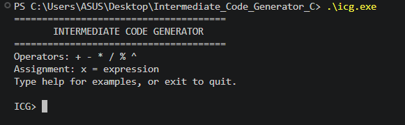
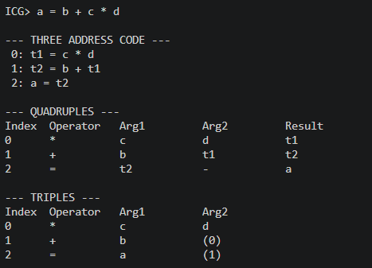
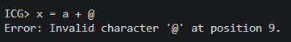

# Intermediate Code Generator in C

A menu-driven **Intermediate Code Generator (ICG)** implemented in C that converts arithmetic expressions into three commonly used intermediate representations:

- Three Address Code (TAC)
- Quadruples
- Triples

The project demonstrates important concepts of Compiler Design, including lexical analysis, syntax analysis, operator precedence, associativity, and intermediate code generation.

---

## Table of Contents

1. [Overview](#overview)
2. [Objectives](#objectives)
3. [Features](#features)
4. [Technologies Used](#technologies-used)
5. [Project Structure](#project-structure)
6. [Supported Operators](#supported-operators)
7. [How to Run](#how-to-run)
8. [Sample Input and Output](#sample-input-and-output)
9. [Screenshots](#screenshots)
10. [How It Works](#how-it-works)
11. [Limitations](#limitations)
12. [Future Enhancements](#future-enhancements)
13. [Conclusion](#conclusion)

---

## Overview

Intermediate Code Generation is an important phase of a compiler. It converts source code into an intermediate representation that acts as a bridge between the source program and the target machine code.

This project implements a simple Intermediate Code Generator using the C programming language. It accepts arithmetic expressions as input, analyses their structure, and generates intermediate representations.

For example, the expression:

```text
a = b + c * d
```

is converted into Three Address Code, Quadruples, and Triples while respecting operator precedence.

---

## Objectives

- Understand the role of Intermediate Code Generation in compiler design.
- Implement lexical analysis to identify valid tokens.
- Implement syntax analysis using recursive descent parsing.
- Handle operator precedence and associativity.
- Generate Three Address Code, Quadruples, and Triples.
- Detect invalid characters and syntactically incorrect expressions.

---

## Features

- **Lexical Analysis:** Identifies identifiers, numeric constants, operators, assignment symbols, and parentheses.
- **Syntax Analysis:** Uses recursive descent parsing to validate arithmetic expressions.
- **Three Address Code:** Generates intermediate instructions using temporary variables.
- **Quadruples:** Represents instructions using operator, argument 1, argument 2, and result.
- **Triples:** Represents instructions using operator and operands, with references to previous instruction indices.
- **Operator Precedence:** Correctly handles multiplication, division, modulo, addition, and subtraction.
- **Exponentiation:** Supports right-associative exponentiation.
- **Unary Minus:** Supports negative expressions.
- **Error Handling:** Detects invalid characters and malformed expressions.
- **Interactive Interface:** Accepts multiple expressions through a command-line interface.

---

## Technologies Used

| Technology | Purpose |
|---|---|
| C | Core implementation |
| GCC | C compiler |
| Standard C Library | Input handling and string operations |
| Recursive Descent Parsing | Syntax analysis |
| Command Line Interface | User interaction |

---

## Project Structure

```text
Intermediate-Code-Generator/
│
├── icg.c
├── icg.exe
├── README.md
│
└── screenshots/
    ├── all_representations.png
    ├── error_handling.png
    └── main_interface.png
    
```


*Note: `icg.exe` is the compiled executable and does not need to be committed to GitHub. You can compile it from the source code.*

---

## Supported Operators

| Operator | Operation |
|---|---|
| `+` | Addition |
| `-` | Subtraction / Unary Minus |
| `*` | Multiplication |
| `/` | Division |
| `%` | Modulo |
| `^` | Exponentiation |
| `()` | Parentheses |
| `=` | Assignment |

### Operator Precedence

The parser follows the following precedence rules:

1. Parentheses
2. Exponentiation
3. Unary minus
4. Multiplication, Division, Modulo
5. Addition, Subtraction

Exponentiation is right-associative.

---

## How to Run

### Prerequisites

- Windows operating system
- GCC compiler (MinGW-w64 / MSYS2 UCRT64)
- Visual Studio Code or any C-compatible editor

### Step 1: Clone the Repository

```bash
git clone https://github.com/aryanchoudhary7/Intermediate-Code-Generator.git
```

Navigate to the project directory:

```bash
cd Intermediate-Code-Generator
```

### Step 2: Compile the Program

Open the terminal and execute:

```bash
gcc -std=c99 -Wall -Wextra -Wpedantic icg.c -o icg.exe
```

### Step 3: Run the Program

In Windows PowerShell:

```powershell
.\icg.exe
```

### Step 4: Enter an Expression

Example:

```text
ICG> a = b + c * d
```

To view available commands, enter:

```text
help
```

To exit:

```text
exit
```

---

## Sample Input and Output

### Input

```text
ICG> a = b + c * d
```

### 1. Three Address Code (TAC)

```text
0: t1 = c * d
1: t2 = b + t1
2: a = t2
```

### 2. Quadruples

| Index | Operator | Argument 1 | Argument 2 | Result |
|---|---|---|---|---|
| 0 | * | c | d | t1 |
| 1 | + | b | t1 | t2 |
| 2 | = | t2 | - | a |

### 3. Triples

| Index | Operator | Argument 1 | Argument 2 |
|---|---|---|---|
| 0 | * | c | d |
| 1 | + | b | (0) |
| 2 | = | a | (1) |

Here, `(0)` and `(1)` refer to the results of previously generated instructions.

---

## Screenshots

### 1. Main Interface


### 2. Intermediate Code Representations


### 3. Error Handling


---

## How It Works

The project follows a sequence of compiler phases:

**1. Input Handling**

The user enters an arithmetic expression through the command-line interface.

**2. Lexical Analysis**

The input is scanned and divided into tokens such as identifiers, numbers, operators, and parentheses.

**3. Syntax Analysis**

A recursive descent parser checks the grammatical structure of the expression and applies operator precedence and associativity rules.

**4. Intermediate Code Generation**

As the parser processes the expression, it generates intermediate instructions using temporary variables.

**5. Representation Generation**

The generated instructions are displayed in three formats:

- Three Address Code
- Quadruples
- Triples

**6. Error Handling**

If an invalid character or malformed expression is encountered, the program reports an error instead of generating incorrect intermediate code.

---

## Limitations

- Supports arithmetic expressions and assignment statements only.
- Does not support relational or logical expressions.
- Does not implement conditional statements or loops.
- Does not generate machine code or execute the input expressions.
- Does not implement complete compiler phases such as semantic analysis and code optimization.

---

## Future Enhancements

- Support relational and logical operators.
- Extend the grammar to support conditional statements and loops.
- Implement basic intermediate code optimization.
- Add support for more complex language constructs.
- Develop a graphical user interface.

---

## Conclusion

This project demonstrates the implementation of an Intermediate Code Generator using C. It provides a practical understanding of lexical analysis, recursive descent parsing, operator precedence, and intermediate representations.

By generating Three Address Code, Quadruples, and Triples for arithmetic expressions, the project illustrates how a compiler transforms source-level expressions into structured intermediate instructions.

---

**Developed as part of the Compiler Design academic project.**

**Language:** C  
**Topic:** Intermediate Code Generation  
**Repository:** [GitHub](https://github.com/aryanchoudhary7/Intermediate-Code-Generator)